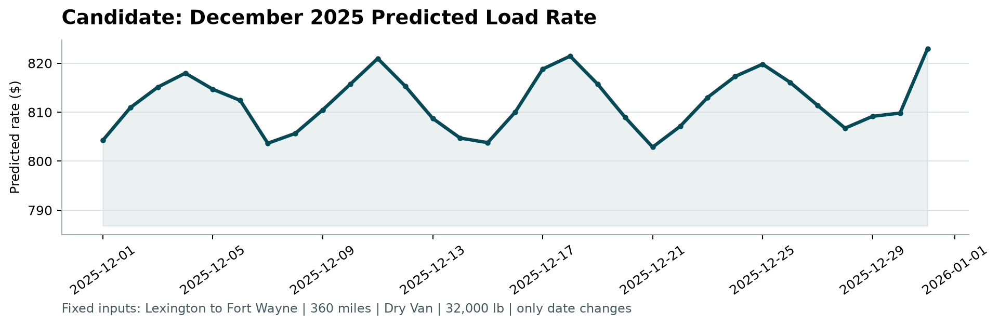

# Freight Rate Prediction: Approach and Results

## Summary
- **Model:** gradient-boosted trees (scikit-learn `HistGradientBoostingRegressor`) that predict log(rate per mile). The predicted rate is that value converted back and multiplied by distance.
- **Validation:** a time-based holdout (train Jan–Aug 2025, test Sep–Oct 2025), plus an expanding-window backtest.
- **Holdout result:** MAE $54, MAPE 2.1%, RMSE $95. The best simple baseline (median rate per mile for each lane and equipment type) gets MAE $89, MAPE 3.75%.
- **Outputs:**
  - `validation_predictions.csv`: 12,000 rows, passes `score.py`
  - `december-chart-inputs.csv`: 31 days, filled in
  - `scorer_results/candidate_december.png`

## How to run
```bash
python3 -m venv .venv && source .venv/bin/activate
pip install -r requirements.txt
python train.py      # trains, validates, writes both prediction files + metrics.json
python score.py --predictions validation_predictions.csv --december-predictions december-chart-inputs.csv
```

---

## Step by step: what I did and why

### Step 1: Checked the files were safe
Before installing anything, I read `score.py`, `requirements.txt`, the CSVs and the PDF. The scorer only validates files and draws a chart. The requirements are standard packages. No CSV cell starts with a formula character (protection against spreadsheet formula injection).

### Step 2: Explored the data
| | Train (`train-test.csv`) | Validation (`validation.csv`) |
|---|---|---|
| Rows | 48,000 | 12,000 |
| Dates | Jan 1 – Oct 31, 2025 | Nov 1 – Dec 31, 2025 |
| Target | `posted_rate` | not given |

Key findings:
- **Distance drives price.** The correlation between distance and rate is 0.91. Rate per mile is very stable, with a median of about $2.15/mile: Reefer $2.31, Flatbed $2.22, Dry Van $2.05.
- **Weight, `market_index` and `quote_signal` each have almost no direct correlation with rate** (|r| < 0.05). They can still help in combination with other features, so I kept them.
- **Rates vary by month and weekday.** The average rate rises from about $2.26k in January to a peak of about $2.50k in June, then eases. Mid-week loads (Wed/Thu) are slightly more expensive than weekend loads.
- **The validation set covers a future period** (Nov–Dec), with no date overlap with training. A random train/test split would therefore overstate accuracy.
- **New cities appear in validation.** 8 cities (Chicago, Charlotte, San Diego, Laredo, Knoxville, Norfolk, Allentown, Jackson) never appear in training. They affect 1,447 validation rows (12%).

### Step 3: Found and fixed data-quality issues
| Issue | Rows (train) | Fix |
|---|---|---|
| Negative weight (e.g. -47,500 lb) | 292 | Took the absolute value. The magnitudes are normal, so the minus sign is an entry error. |
| Missing weight | 300 | Left as missing. The model handles NaN natively and learns its own default. |
| Missing `market_index` | 374 | Left as missing, and added an `mi_missing` flag so the model can tell missing values apart. |
| Wrong prices (label errors) | 675 (1.4%) | Dropped from training (see below). |

**How I found the wrong prices.** For each load, I computed rate per mile divided by the median rate per mile for its equipment type. 98.5% of loads fall between 0.7× and 1.5×. The rest form separate clusters:
- **About 0.1–0.5×:** e.g. a 57-dollar rate for a long haul
- **About 2–6×:** e.g. $24,140 for a Los Angeles–Syracuse trip that normally costs about $6k

The gaps between these clusters and the normal band look like typing or decimal errors, not real market prices. I kept the band from 0.6× to 2.0× and dropped everything outside it.

**Why drop instead of correct?** The error factor isn't consistent, so a "fix ×10" rule would be a guess. Dropping 1.4% of rows loses little information.

I never drop rows from the 12,000 validation loads. Every one gets a prediction.

### Step 4: Built features
- **Lane:** distance, plus pickup and delivery latitude/longitude.
- **Load:** equipment (as a category), weight.
- **Market:** `market_index`, `mi_missing`, `quote_signal`.
- **Calendar:** month, day of week, day of year.

I left out city names on purpose. Because 12% of validation rows involve a city the model has never seen, a city-name feature would be useless for them. Coordinates, by contrast, place a new city next to known ones. I tested this by hiding 8 random cities from training and comparing (Step 6).

**Target transform.** I predict log(rate ÷ distance) and convert back. Two reasons:
1. A $50 error matters more on a $500 load than on a $5,000 load, and a log target makes errors relative.
2. The trees only need to learn "price per mile". Distance enters the prediction through the final multiplication, so the model doesn't have to approximate it in steps.

### Step 5: Chose the train/validation split
The real task is to train on the past and predict the next two months, so the split follows time:
- **Main holdout:** train on Jan–Aug (37,945 rows), test on Sep–Oct (9,380 rows). This mirrors the real setup of training on Jan–Oct and predicting Nov–Dec.
- **Backtest:** I repeated the exercise three times with an expanding training window, to check that the result isn't luck:

| Train months | Test months | MAE | MAPE | RMSE |
|---|---|---|---|---|
| Jan–Apr | May–Jun | $55 | 2.0% | $104 |
| Jan–Jun | Jul–Aug | $105 | 4.4% | $167 |
| Jan–Aug | Sep–Oct | $54 | 2.1% | $95 |

The Jul–Aug window is the hardest. That window follows the June peak, when rates turn down. The model trained through June has no example of that turn, so this is the expected weak spot of any model that extrapolates by calendar.

**Caveat.** Test-period metrics are measured after the same label cleaning. Including the obviously wrong prices would mostly measure the typos, not the model.

### Step 6: Picked the model
**Baselines first.** A simple, explainable rule sets the bar:

| Method (Sep–Oct holdout) | MAE | MAPE | RMSE |
|---|---|---|---|
| Median $/mile by equipment × distance | $176 | 8.1% | $262 |
| Median $/mile by lane + equipment × distance | $89 | 3.75% | $143 |
| **Gradient-boosted trees (final)** | **$54** | **2.1%** | **$95** |

Why gradient-boosted trees:
- They're strong on tabular data with mixed numeric and categorical features.
- They handle missing values without imputation tricks.
- They capture interactions such as equipment × region × season automatically.

I used scikit-learn's version, so no extra library like LightGBM or XGBoost was needed.

**City names vs coordinates.** I ran 3 trials, each hiding 8 random cities from training. The coordinates-only model was better on unseen cities in 2 of 3 trials, and only slightly worse on seen cities (average MAPE 2.06% vs 2.02%). I chose coordinates because they generalise to new cities and keep the model simpler.

**Iteration that mattered.** My first outlier cutoff was 3× the median. It left a cluster of 3–4× errors in the data, and holdout RMSE was $327. Looking at the largest errors showed those mislabelled long hauls. Tightening the cutoff to the natural gap at 2× brought RMSE down to $95.

### Step 7: Trained the final model and predicted
1. Refit the model on all cleaned Jan–Oct data (47,325 rows).
2. Predicted all 12,000 validation loads.
3. Merged the predictions onto the template by `load_id` and saved `validation_predictions.csv` (columns: `load_id,predicted_rate`).
4. **December chart.** The December inputs have no `market_index`, `quote_signal` or coordinates.
   - Coordinates come from the city lookup built from training data.
   - For each December date, the market signals are that date's average across the validation loads, which do cover December. This uses the best available market view for each day rather than a constant.
5. Ran `score.py`. It passes both checks and creates the chart.

### Step 8: Sanity-checked the outputs
- **Validation predictions:** they range from $182 to $6,854, with a mean of $2,369. The training mean is $2,374, so there are no negative or absurd values.
- **December chart:**
  - Rates stay in a narrow $803–$823 band for 360 miles of Dry Van, about $2.25/mile, in line with the data.
  - Prices peak mid-week and dip at weekends, matching the weekday pattern in the training data.
  - There's no December-specific seasonality, because the model has never seen a December. That's an honest limitation, not a bug.



## Limitations and next steps
- **No December history.** Holiday-season effects can't be learned from Jan–Oct data. A second year of data would fix this.
- **The cleaning thresholds are data-driven but manual.** In production I'd flag these loads for review rather than silently drop them.
- **If more time:** a tuned LightGBM, lane-level target encoding, and prediction intervals for quoting.

## Files
| File | Purpose |
|---|---|
| `train.py` | Full pipeline: clean → features → validate → fit → predict |
| `metrics.json` | Data-quality counts, holdout and backtest metrics |
| `validation_predictions.csv` | Submission file |
| `december-chart-inputs.csv` | Filled December predictions |
| `scorer_results/candidate_december.png` | Chart for the report |
